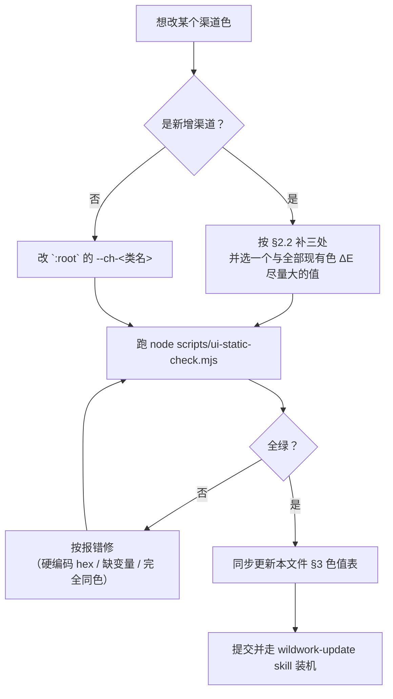

# 渠道配色规范

> **状态：本文件是渠道配色的唯一规范来源。** 当前 25 个内建渠道的色值即**规范基线**，
> 已全部落到 `cmd/wild-work/web/style.css` 的 `:root` 并处于生产运行状态。
> 改色 = 改规范，必须同时改本文件的色值表与「变更流程」，不能只改 CSS。
>
> 关联决议：[`决议项.md`](决议项.md) 的 **R99**（配色单一来源）。

---

## 1. 为什么需要这份规范

渠道色在面板上有 **5 个渲染点**，它们必须永远同色：

```mermaid
flowchart LR
  V["`:root` --ch-&lt;类名&gt;<br/>唯一真源"] --> A["账号卡片徽章"]
  V --> B["积分汇总条 chip"]
  V --> C["折线图 series"]
  V --> D["费率表渠道 tab"]
  V --> E["平台表 / 运行统计"]
  A --> F["chBadge()<br/>底色 = chColor()"]
  C --> F
```

**历史故障（R99 的由来）**：2026-10-17 连加 6 个渠道（Kilo/MiniMax/LobsterAI/
ZCode/Gemini/CodeArts）时，只写了 `.badge.x { background: #hex }` 而**漏了 `--ch-x` 变量**。
折线图 `chColor()` 读不到变量就静默回退 `#6366f1`，导致这 6 条线在图上全挤成同一个靛蓝，
而下方徽章各是各的颜色——同一渠道两处不一致。

**根因不是"忘了加一行"，而是当时存在两套颜色来源**（CSS 变量 vs 硬编码 hex）。
所以规范的第一条不是色值，而是**来源唯一**。

---

## 2. 三条硬性规则

### 2.1 颜色只能有一个来源

| 允许 | 禁止 |
|---|---|
| `:root { --ch-<类名>: #rrggbb; }` | 任何 CSS 规则里写死渠道 hex（`.badge.x { background: #2563eb }`） |
| `background: var(--ch-x)` | 在 JS 里内联渠道色常量表 |
| `chBadge(k)` 渲染徽章（底色 = `chColor(k)`） | 手拼 `<span class="badge ${chClass(k)}">` |

`ui-static-check` 有全仓扫描断言：CSS 里任何渠道相关规则出现非 `#fff` 的 hex 直接失败。

### 2.2 新增渠道必须同时补三处

漏任何一处都会静默降级（不报错、只是颜色不对，最难发现）：

1. `style.css` 的 `:root` → 加 `--ch-<类名>: #rrggbb;`
2. `style.css` → 加 `.badge.<类名> { background: var(--ch-<类名>); }`
3. `style.css` → 加 `.btn.primary.alt.<类名> { background: var(--ch-<类名>); border-color: var(--ch-<类名>); }`
4. `app.js` 的 `CH_CLASS` → 加 `<key>: "<类名>"`（并同步 `CH_LABEL`）

> ⚠️ 漏第 1 条：`chColor()` 回退 `#6366f1`，新渠道在图上与所有漏配渠道撞成同色。
> ⚠️ 漏第 2 条：徽章无底色（透明），在浅色卡片上几乎看不见。
> ⚠️ 漏第 3 条：添加按钮落到 `.btn.primary.alt` 的兜底色（现与 `--ch-custom` 同值，改色板时静默错色）。
> ⚠️ 漏第 4 条：前端 `chClass()` 回退 `custom`，徽章/按钮/折线三处一起走兜底色。

### 2.3 自定义渠道不用固定色池

自定义渠道（R66）名称由用户配置、运行期可增删，**没有品牌色**，故按序号取色：

- 色相 = `(序号 × 137.508°) mod 360`（黄金角，保证任意数量下相邻序号间隔最大）
- 明度从 42% 逐级下压，直到**白字对比 ≥ 4.5**（黄/绿最亮，要压到 28% 左右）
- 缓存键必须是 `` `${k}#${idx}` ``——只按渠道名缓存时，删/调序后会返回过期颜色

不用固定色池：色池在渠道数超过池长时必然撞色，哈希取模也可能少量渠道就落进同一桶。

---

## 3. 规范色值表（25 个内建渠道）

按**辨识度**从高到低排序（「最近邻 ΔE」= 与全部其他渠道中最接近那个的 CIEDE2000 距离，
越大越安全）。这张表就是基线，改任何一个值都要走 §5 的流程。

> ⚠️ 两列 key 用途不同，不要混：**CSS 变量名**（短类名，如 `wb`）用于 `--ch-wb` 与 `.badge.wb`；
> **渠道 key**（如 `workbuddy`）是后端 `provider.Kind` 与 `CH_CLASS`/`CH_LABEL` 的键。
> 这张表由 `ui-static-check` 与 `:root` **逐值比对**，改 CSS 不改这里会直接测试失败。

| # | CSS 变量名<br/>`--ch-<类名>` | 渠道 key<br/>(`CH_CLASS`) | 显示名 | 色值 | 白字对比 | 最近邻 ΔE | 取色依据 |
|---|---|---|---|---|---|---|---|
| 1 | `traecode` | `traecode` | TraeCode | `#0284c7` | 4.10 | workbuddy 14.8 | TraeCode 电光海青（Trae 2.0 渐变海天青，彻底摆脱旧深紫，与 sgproxy 彻底拉开） |
| 2 | `raccoon` | `raccoon` | 小浣熊 | `#8e6bf2` | 3.79 | workbuddy 14.3 | 小浣熊 浅紫罗兰（商汤小浣熊客户端品牌色） |
| 3 | `codearts` | `codearts` | CodeArts | `#991b1b` | 8.31 | officeace 14.0 | CodeArts 华为云深绯红 |
| 4 | `qodercn` | `qodercn` | QoderCN | `#c026d3` | 4.71 | qodercom 12.5 | QoderCN 极光品红 |
| 5 | `glm` | `glm` | 智谱清言 | `#1e3a8a` | 10.36 | oczen 12.4 | 智谱清言 深海宝蓝（智谱官方科技深蓝，告别黑夜般的深暗） |
| 6 | `qoder` | `qoder` | Qoder | `#db2777` | 4.60 | lobsterai 12.4 | Qoder 腾讯桃红 |
| 7 | `zcode` | `zcode` | ZCode | `#581c87` | 10.88 | gemini 10.9 | ZCode 极客深紫檀 |
| 8 | `gemini` | `gemini` | Gemini | `#88117c` | 8.68 | zcode 10.9 | Gemini 官方星云品紫 |
| 9 | `oczen` | `oczen` | OpenCodeZen | `#475569` | 7.58 | kilo 10.8 | OpenCodeZen 禅意石板灰 |
| 10 | `kilo` | `kilo` | Kilo | `#164e63` | 9.11 | oczen 10.8 | Kilo 深冷松蓝 |
| 11 | `monkeycode` | `monkeycode` | MonkeyCode | `#4d7c0f` | 4.99 | cline 10.7 | MonkeyCode 生机草绿 |
| 12 | `wb` | `workbuddy` | WorkBuddyCN | `#2563eb` | 5.17 | qwenwork 10.1 | WorkBuddyCN 蓝（经典科技蓝） |
| 13 | `qodercom` | `qodercom` | QoderCOM | `#7e22ce` | 6.98 | qwenwork 9.6 | QoderCOM 紫罗兰（告别旧深棕） |
| 14 | `qwenwork` | `qwenwork` | 千问办公 | `#4f46e5` | 6.29 | qodercom 9.6 | 千问办公 通义紫（阿里通义千问官方极光紫，告别暗青蓝） |
| 15 | `officeace` | `officeace` | OfficeAce | `#dc2626` | 4.83 | lobsterai 9.2 | OfficeAce 华为中国红 |
| 16 | `lobsterai` | `lobsterai` | LobsterAI | `#e11d48` | 4.70 | officeace 9.2 | LobsterAI 龙虾珊瑚红 |
| 17 | `wbai` | `workbuddyai` | WorkBuddyAI | `#0f766e` | 5.47 | traework 9.2 | WorkBuddyAI 极光青绿（深邃清爽，与科技蓝呼应） |
| 18 | `trae` | `traework` | TraeWork | `#047857` | 5.48 | cline 8.7 | TraeWork 智能翠绿（Trae 官方核心色 Intelligent Green） |
| 19 | `cline` | `cline` | Cline | `#15803d` | 5.02 | traework 8.7 | Cline 机器人深绿 |
| 20 | `loomy` | `loomy` | Loomy | `#b45309` | 5.02 | minimax 6.9 | Loomy 暖金琥珀 |
| 21 | `minimax` | `minimax` | MiniMax | `#c2410c` | 5.18 | loomy 6.9 | MiniMax 活力暖橙（海螺 AI 官方品牌橙，告别橄榄屎黄） |
| 22 | `comate` | `comate` | WPS Comate | `#d97706` | 3.68 | — | WPS Comate 琥珀橙（WPS 品牌色系） |
| 23 | `lingxi` | `lingxi` | WPS 灵犀 | `#7c3aed` | 5.70 | qodercom 6.1 | WPS 灵犀 电紫（kdocs 灵犀助手品牌色系，与 comate 橙拉开 ΔE；实测 qodercom/qwenwork 两对紫色系邻距 6.1/6.5，低于旧基线 6.9，属已知取舍） |
| 24 | `modelscope` | `modelscope` | ModelScope | `#0369a1` | 5.93 | traecode 10.4 | ModelScope 魔搭国内站 柔蓝（魔搭品牌蓝；与 TraeCode 电光海青同属蓝系但明度差足够，ΔE 10.4 是它最近的一对） |
| 25 | `modelscopeai` | `modelscopeai` | ModelScopeAI | `#854d0e` | 6.85 | loomy 11.1 | ModelScopeAI 魔搭国际站 暗金（与国内站柔蓝拉开 83.8 ΔE，一眼可分）。**原案 `#b45309` 与既有 loomy 完全同色（ΔE 0）**，违反「无完全同色」硬约束 ⇒ 取同色相更暗一档 `#854d0e` |

**基线统计**：

| 指标 | 值 | 说明 |
|---|---|---|
| 渠道数 | 25 | 另有 `--ch-custom` 作自定义渠道兜底（实际走黄金角色，见 §2.3） |
| 最小两两 ΔE2000 | **6.1**（lingxi vs qodercom） | 见 §4 已知限制 |
| 白字对比 < 4.5 | **2 个**（traecode 4.10、raccoon 3.79） | 见 §4 已知限制 |
| 完全同色对 | **0** | `ui-static-check` 有断言锁定 |

---

## 4. 已知限制（基线现状，不是待办）

以下两项是**当前基线的既定取舍**，记录在此是为了让后来者知道「这是已知的，
不是又坏了」，而不是要求立刻修改：

1. **最小 ΔE2000 = 6.1**（lingxi `#7c3aed` vs qodercom `#7e22ce`），共 16 对 < 14。
   lingxi 与 qodercom/qwenwork 同为紫色系，若同一张折线图上同时出现，肉眼较难区分。
   **为什么没改**：lingxi 电紫是 kdocs 灵犀助手品牌色系（与 comate 橙拉开距离是硬需求，
   WPS 双渠道在面板上必须一眼可分），紫色系可选余地本就小；而实际使用中 lingxi 与
   qodercom/qwenwork 很少同时有大量用量。`ui-static-check` 当前的把关是「23 色两两不同」
   （拦完全撞色），**未做 ΔE 阈值校验**。

2. **2 个渠道白字对比不足 WCAG AA 4.5**：traecode 4.10、raccoon 3.79。
   `.badge` 文字色恒为 `#fff`，没有自适应逻辑。这两个徽章文字会略显糊。
   **为什么没改**：文字色自适应（浅底切深灰字）会改变徽章观感，属视觉决策；
   徽章字号仅 10px，实际可读性影响有限。

> 若将来要收紧：优先补 `chColorText()` 做文字色自适应（不动色相，副作用最小），
> 其次才是调色值。调色值请务必先出对比截图。

---

## 5. 变更流程



**必跑检查**：

```bash
node scripts/ui-static-check.mjs    # 配色单一来源一组 21 条断言
```

**必须同步更新**：本文件 §3 的表格（色值 / 白字对比 / 最近邻 ΔE）。
只改 CSS 不改文档 = 文档立刻变成错误信息。

**装机**：改的是 `cmd/wild-work/web/` 下的静态资源，走
[`wildwork-update`](../../.agents/skills/wildwork-update/SKILL.md) skill 热替换，
不要手动 cp 二进制。

---

## 6. 断言清单（`ui-static-check.mjs`）

「渠道配色单一来源（R99）」一组共 21 条，覆盖：

| 类别 | 断言 |
|---|---|
| 来源唯一 | 25 个渠道都有 `--ch-*` 变量 / `.badge.x` 全走 `var(--ch-x)` / 徽章统一经 `chBadge()` 且底色 = `chColor()` |
| 无硬编码 | 渠道按钮无 hex / 渠道相关 CSS 规则无 hex（白字除外）/ CSS 规则无重复定义 |
| 自定义渠道 | 黄金角均分（不用固定色池）/ 缓存键含序号 / 白字对比自动 ≥ 4.5 |
| 辨识度 | 25 色两两不同（无完全同色） |
| 一致性 | `RESERVED_CHANNEL_NAMES`、`CH_SUMMARY_ORDER`、`NO_EXPLICIT_CHECKIN` 均覆盖全部内建渠道 / 渠道显示名只有一个来源 / CSS 选择器都有渲染点（无死规则） |
